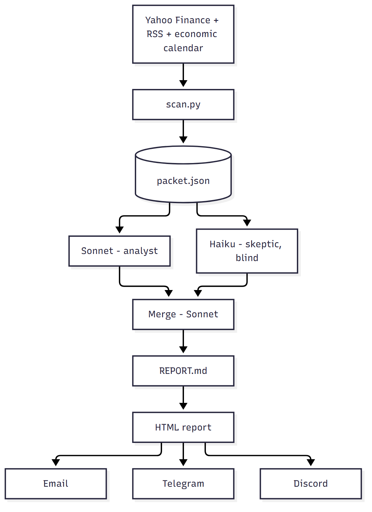
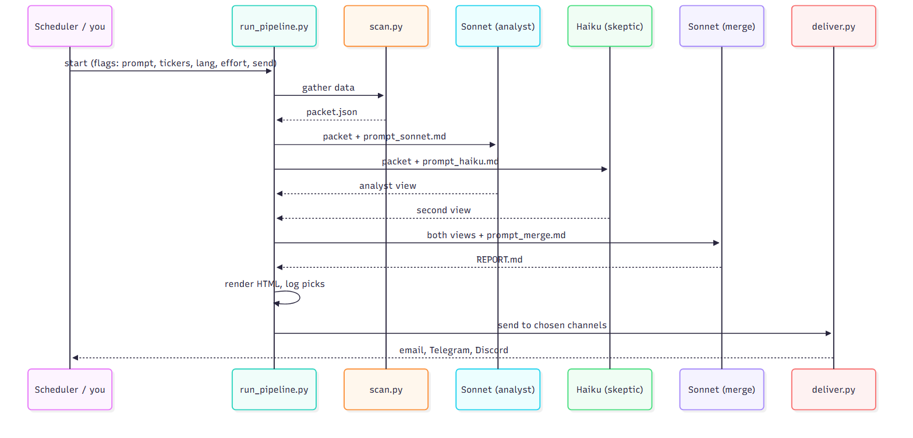

# 📈 Trading Tools - Market Screener

<details open>
<summary> <b>Brief Review</b></summary>

A daily **AI premarket report** built with free data, two Claude models and a set of Claude Code skills for trade analysis. A scanner collects Yahoo Finance data, RSS news and the economic calendar into one packet. Sonnet (analyst) and Haiku (skeptic, blind) read it independently, Sonnet merges both views into a report, and the report is rendered to HTML and sent by email, Telegram and Discord.

> Educational only, not financial advice.

<p align="center">

</p>

The project tree:

```
.claude/skills/
  premarket-gatherer/       scan.py: Yahoo Finance, RSS and calendar data into packet.json
  run-premarket-pipeline/   run_pipeline.py and the schedule / unschedule scripts
  report-template/          fixed 12-section blueprint and example report
  report-renderer/          render_report.py: REPORT.md to HTML
  report-delivery/          deliver.py: email, Telegram, Discord
  pick-scorer/              score_picks.py: scores logged picks
  watchlist-criteria/       WATCHLIST_CRITERIA.md: the scanner rules
  premarket-report/         standalone report and its config.json
  (other skills)            market scans and broker-CSV trade analysis
logs/                       pipeline logs and picks_log.csv (runtime)
reports/                    premarket_<date>.html (runtime)
prompt_sonnet.md            analyst prompt
prompt_haiku.md             skeptic prompt
prompt_merge.md             merge prompt
.env                        keys for delivery (never share)
```

**Contents:** [Quick start](#-quick-start) · [Install](#-install) · [Configure](#-configure) · [Run](#-run) · [Examples](#-examples) · [Schedule](#-schedule) · [Improve the report](#-improve-the-report) · [Skills](#-skills) · [Limits](#-known-limits) · [Uninstall](#-uninstall)

</details>

<details open>
<summary> <b>Setup</b></summary>

## 🚀 Quick start

1. [Install](#-install) the environment.
2. [Configure](#-configure) your keys in `.env` (optional until you want delivery).
3. Build a report without sending anything, then open `reports/premarket_<date>.html`:

```
.venv\Scripts\python .claude\skills\run-premarket-pipeline\run_pipeline.py --send none
```

**Natural language (Claude Code):** open Claude Code in the project folder and say *"Build today's premarket report but don't send it anywhere."*

## 🗣️ Use it in natural language

You don't have to remember any command or flag. Open Claude Code in the project root (`claude`) and describe what you want; Claude picks the right skill and runs the same scripts shown in the code examples.

**Best approach**

1. **Start from the project root**, so the skills in `.claude/skills/` are loaded and `.venv` and `.env` are found.
2. **Say the goal, plus any choices that matter:** topic or tickers, language, which channels send, how much effort, and when. Anything you leave out uses the default (Spanish, `low` effort, every configured channel).
3. **Name the skill when you want to be sure.** Typing `/run-premarket-pipeline build today's report` always uses that skill. Plain sentences usually work too, because each skill describes when it should be used.
4. **Ask for a dry run first** if you are unsure ("show me the plan, don't run it"): it maps to `--dry-run` and makes no billed AI calls.
5. **Mind the cost.** A full run makes 3 billed `claude -p` calls, so Claude should confirm what it is about to run if your request is ambiguous.

| You say | It maps to |
|---|---|
| "Build today's premarket report, don't send it" | `run_pipeline.py --send none` |
| "Run the report in English with a deep dive on NVDA and AMD" | `--lang english --tickers NVDA,AMD --prompt "..."` |
| "Send only to Telegram" | `--send telegram` |
| "Test my email, Telegram and Discord keys with the last report" | `deliver.py reports\premarket_<date>.html REPORT.md` |
| "Schedule it every weekday at 08:00 ET in English" | `schedule_windows.ps1 -TimeET 08:00 -PipelineArgs '--lang english'` (or `schedule_linux.sh`) |
| "Did yesterday's picks work?" | `pick-scorer` (`score_picks.py`) |

Each section below also shows its natural-language version next to the code.

## 📦 Install

Needs [uv](https://docs.astral.sh/uv/), Python 3.14 and the [Claude Code CLI](https://claude.com/claude-code) (`claude` on PATH).

```
uv venv .venv --python 3.14
uv pip install yfinance feedparser markdown requests pandas
```

Activate: `.venv\Scripts\activate` (Windows) or `source .venv/bin/activate` (Linux/macOS).

## 🔑 Configure

```
copy .env.example .env        # Linux/macOS: cp .env.example .env
```

| Key | Used for | Where to get it |
|---|---|---|
| `RESEND_API_KEY`, `EMAIL_TO` | 📧 Email | https://resend.com/api-keys (the default sender only delivers to your Resend account email) |
| `EMAIL_FROM` | Optional sender | Verified domain at https://resend.com/domains |
| `TELEGRAM_BOT_TOKEN`, `TELEGRAM_CHAT_ID` | 💬 Telegram | @BotFather `/newbot`, then `getUpdates` for the chat id |
| `DISCORD_WEBHOOK_URL` | 🎮 Discord | Channel > Integrations > Webhooks |

> 🔒 `.env` holds secrets: never share it. Channels with empty keys are skipped.

**Telegram chat id:** open your bot in Telegram, press Start, send `hi`, then open `https://api.telegram.org/bot<TOKEN>/getUpdates` and copy `chat` > `id` (negative for groups). `result: []` means you haven't messaged the bot yet.

### Test delivery

Uses an existing report, no AI calls, no cost. Every configured channel sends once:

```
.venv\Scripts\python .claude\skills\report-delivery\deliver.py reports\premarket_<date>.html REPORT.md
```

**Natural language:** *"Test my delivery channels with the latest report, no AI calls."* (skill: `report-delivery`). Add *"and help me find my Telegram chat id"* if you need it.

**Troubleshooting: what the output means**

| Output line | Meaning / fix |
|---|---|
| `email sent ...` / `telegram sent` / `discord sent` | ✅ Working |
| `... skipped, set ...` | Key is empty in `.env` |
| `telegram failed, 400 ... chat not found` | Wrong `TELEGRAM_CHAT_ID`, or you never messaged the bot |
| `telegram failed, 401` | Wrong `TELEGRAM_BOT_TOKEN` |
| `discord failed, 404` | Webhook URL deleted or mistyped |
| `email failed, Resend 403` | Sender not allowed: use your Resend account email, or verify a domain |

### Choose the channels

Pick channels per run without touching `.env` (also works in scheduled runs):

```
run_pipeline.py --send telegram            # Telegram only
run_pipeline.py --send email,discord       # any combination
run_pipeline.py --send none                # build the report, send nothing
deliver.py reports\premarket_<date>.html REPORT.md --only telegram   # test one channel
```

**Natural language:**

- *"Run the report and send it to Telegram only."*
- *"Send it by email and Discord."*
- *"Build the report but don't send anything."*
- *"Test only Telegram with the last report."*

Filters live in `.claude/skills/watchlist-criteria/WATCHLIST_CRITERIA.md` (spec), `.claude/skills/premarket-report/scripts/config.json` (standalone report) and `scan.py` (pipeline flags).

</details>

<details open>
<summary> <b>Using the Market Screener</b></summary>

## ▶️ Run

Run from the project root. Paths assume Windows; on Linux use `.venv/bin/python`.

```
.venv\Scripts\python .claude\skills\run-premarket-pipeline\run_pipeline.py [options]
```

**Natural language:** *"Run the full premarket pipeline."* Add the options in plain words: *"in English"* (`--lang`), *"with higher effort on the analyst"* (`--effort analyst=high`), *"include NVDA and AMD"* (`--tickers`), *"focus on semiconductors"* (`--prompt`), *"don't send it"* (`--send none`), *"just show me the plan"* (`--dry-run`).

| Option | What it does | Default |
|---|---|---|
| `--prompt "text"` | Steers the analysis for this run (sector, ticker, instrument) | none |
| `--tickers A,B` | Adds these names to the data even if they didn't gap | none |
| `--lang LANGUAGE` | Report language: `spanish`, `english`, or any language | `spanish` |
| `--effort LEVEL` | Reasoning effort: `low` `medium` `high` `xhigh` `max`, for all steps or per step (`analyst=high,second=low,merge=medium`) | `low` |
| `--send LIST` | Channels that send: `all`, `none`, or a list like `email,discord` | `all` |
| `--cleanup BOOL` | After a successful run, delete intermediates (`packet.json`, both views, `REPORT.md`, caches); keeps `reports/` and `logs/` | `true` |
| `--skip-deliver` | Build the report, send nothing | off |
| `--dry-run` | Print the plan only, no AI calls | off |

<p align="center">

</p>

**Single steps**

```
.venv\Scripts\python .claude\skills\premarket-gatherer\scan.py packet.json [--tickers A,B]
.venv\Scripts\python .claude\skills\report-renderer\render_report.py REPORT.md [YYYY-MM-DD]
.venv\Scripts\python .claude\skills\report-delivery\deliver.py reports\premarket_<date>.html [REPORT.md]
```

**Natural language:** *"Only gather the premarket data into packet.json"* (`premarket-gatherer`), *"Render REPORT.md to HTML and open it"* (`report-renderer`), *"Send the last report to my channels"* (`report-delivery`).

Models: Sonnet (analyst), Haiku (second brain), Sonnet (merge), all at `low` effort unless you pass `--effort` (higher is slower and costs more). Change models in `MODELS` in `run_pipeline.py`.

Output: `reports/premarket_<date>.html`, logs in `logs/pipeline_<date>.log`. A failed run always keeps its intermediate files. Each run makes **3 billed `claude -p` calls**.

## 💡 Examples

Options combine freely.

```
# Sector
python .claude\skills\run-premarket-pipeline\run_pipeline.py --prompt "Focus on semiconductors and technology names and explain which have catalysts"

# Ticker(s)
python .claude\skills\run-premarket-pipeline\run_pipeline.py --tickers NVDA,AMD --prompt "Deep dive on NVDA and AMD: catalyst, key levels, risk"

# Instruments (ETFs, futures)
python .claude\skills\run-premarket-pipeline\run_pipeline.py --tickers GLD,CL=F,TLT --prompt "Gold, oil and bonds: what is the macro read for today?"

# Research only, nothing sent
python .claude\skills\run-premarket-pipeline\run_pipeline.py --send none --prompt "Which gappers look like sell-the-news traps?"

# Another language
python .claude\skills\run-premarket-pipeline\run_pipeline.py --lang english
```

**Natural language** (same order as the commands above):

- *"Run the premarket report focused on semiconductors and technology, and explain which names have catalysts."*
- *"Run it with NVDA and AMD added, as a deep dive on catalyst, key levels and risk."*
- *"Include GLD, crude oil futures and TLT and give me the macro read for today."*
- *"Run it without sending anything: which gappers look like sell-the-news traps?"*
- *"Run the report in English."*

- `--prompt` steers that run only (nothing is saved). It is added to the Sonnet, Haiku and merge prompts. Models use only packet data and say so if something is missing. Use quotes around it.
- Without `--tickers`, only the top 12 gappers are in the data.
- `--lang`: section titles, text and the date line are translated; tickers, numbers, price levels, emojis and original news headlines stay as they are. The HTML footer is translated for Spanish and English only (others fall back to English). The email subject stays in English.

## ⏰ Schedule

Weekdays, default **08:15 ET**. The scheduler belongs to the **`run-premarket-pipeline`** skill. Its scripts are in `.claude/skills/run-premarket-pipeline/`:

| File | What it does |
|---|---|
| `schedule_windows.ps1` / `unschedule_windows.ps1` | Create / remove the Task Scheduler task `PremarketPipeline` |
| `schedule_linux.sh` / `unschedule_linux.sh` | Add / remove the cron entry (Linux / macOS) |
| `run_pipeline.py` | The pipeline the schedule runs |

**How to call it**

- **From the terminal:** run the script from that folder (commands in the table below).
- **From Claude Code (natural language):** type `/run-premarket-pipeline` and ask it to schedule the report, for example *"Schedule it every weekday at 08:00 ET in English."* The skill runs the right script for your system. Other requests: *"Is the report scheduled?"* (check), *"Run the scheduled task now"* (test), *"Remove the schedule"* (unschedule).

The schedule is saved by the operating system (Task Scheduler on Windows, crontab on Linux / macOS), not in the project.

| | Windows (PowerShell) | Linux / macOS |
|---|---|---|
| Install | `.\schedule_windows.ps1 [-TimeET 08:00] [-PipelineArgs '<flags>']` | `./schedule_linux.sh [08:00] [<flags>]` |
| Remove | `.\unschedule_windows.ps1` | `./unschedule_linux.sh` |
| Check | `Get-ScheduledTask PremarketPipeline` | `crontab -l` |
| Test now | `Start-ScheduledTask PremarketPipeline` | run `run_pipeline.py` by hand |

### Scheduled runs with flags

Anything after the time is saved into the schedule and used on every run. It works for every `run_pipeline.py` flag. Re-run the install command to change them.

```
# Windows: put the flags in -PipelineArgs (single quotes outside, double quotes inside)
.\schedule_windows.ps1 -TimeET 08:15 -PipelineArgs '--prompt "Focus on semiconductors" --tickers NVDA,AMD --lang english --effort analyst=medium'

# Linux / macOS: flags go after the time
./schedule_linux.sh 08:15 --prompt "Focus on semiconductors" --tickers NVDA,AMD --lang english --effort analyst=medium
```

**Natural language:** *"Schedule the report at 08:15 ET every weekday, focused on semiconductors, with NVDA and AMD, in English, and medium effort on the analyst."*

Telegram only, for example: `-PipelineArgs '--send telegram'` (Windows) or `./schedule_linux.sh 08:15 --send telegram` (Linux / macOS). Without flags, a scheduled run uses the default prompts, Spanish, low effort and every configured channel.

### Why 8:15 ET, and time zones

The pipeline takes about 2 to 3 minutes, so starting at 8:15 ET has the report ready well before the 8:45 ET read. The time is always given in Eastern time (`-TimeET 08:00` / `08:00` to change it). On Windows the script converts the ET time to your PC's local time (for example 8:15 ET = 7:15 AM on a PC in UTC-5 while US daylight saving is on) and prints the result. On Linux the cron entry runs in `America/New_York` time directly. Runs Monday to Friday only; run after 4:00 AM ET so premarket data exists. The PC must be on. On Windows, re-run the install script after a daylight-saving change if your PC isn't on US Eastern time.

## 🎯 Improve the report

Already built in: plan numbers (trigger, stop, 1R, targets) computed in code, a skeptic second brain, an example report in the prompts, validation with one retry, English reasoning with only the merge step translated, extra data (analyst changes, options, Google News headlines) and a pick log.

What you can do:

- **Run at the right time.** Real premarket (about 8:15 ET), not at night: levels and gaps are only meaningful then.
- **True premarket RVOL (optional).** Yahoo has no premarket volume, so RVOL is full-day by default. Add a free Alpaca account's keys to `.env` (`ALPACA_API_KEY_ID`, `ALPACA_API_SECRET_KEY`) and the packet uses real premarket RVOL (untested until you add keys).
- **Spend effort where it counts.** Everything is `low` by default. Try `--effort analyst=medium,merge=medium`; leave the second brain on low.
- **Check if conviction means anything.** Every run logs its picks to `logs/picks_log.csv`. A day later run:
  ```
  .venv\Scripts\python .claude\skills\pick-scorer\score_picks.py
  ```
  Natural language: *"How did yesterday's picks perform by conviction color?"* (skill: `pick-scorer`).

  After 30+ picks per color (green/yellow/red), if green doesn't beat the others, the scoring is noise: tune the prompts. Fills are theoretical.
- **Tune the prompts.** `prompt_sonnet.md`, `prompt_haiku.md`, `prompt_merge.md` and the example in `.claude/skills/report-template/EXAMPLE_REPORT.md` (fictional content, copy its depth and tone).

## 🧩 Skills

Live in `.claude/skills/`; use them as `/name` in Claude Code, or just describe the task in natural language (for example *"Top 10 liquid momentum movers in semiconductors with their latest catalyst and earnings date"* uses `catalyst-screener`; *"Audit my broker CSV"* uses `pnl-audit`).

| Area | Skills |
|---|---|
| Market scans | `catalyst-screener`, `premarket-prep`, `multi-timeframe-check`, `weekly-watchlist-recap`, `post-session-review` |
| Trade analysis (broker CSV) | `pnl-audit`, `strategy-deep-dive`, `pnl-dashboard`, `strategy-rules` |
| Report pipeline | `watchlist-criteria`, `premarket-report`, `premarket-gatherer`, `report-template`, `report-renderer`, `report-delivery`, `run-premarket-pipeline`, `pick-scorer` |

Prompts used by the pipeline sit in the project root: `prompt_sonnet.md`, `prompt_haiku.md`, `prompt_merge.md`.

</details>

<details open>
<summary> <b>Troubleshooting</b></summary>

| Symptom | Fix |
|---|---|
| `... skipped, set ...` | The channel's key is empty in `.env`. |
| `telegram failed, 400 ... chat not found` | Wrong `TELEGRAM_CHAT_ID`, or you never messaged the bot. |
| `telegram failed, 401` | Wrong `TELEGRAM_BOT_TOKEN`. |
| `discord failed, 404` | Webhook URL deleted or mistyped. |
| `email failed, Resend 403` | Use your Resend account email as sender, or verify a domain. |
| No report at the scheduled time | The PC was off. On Windows, re-run `schedule_windows.ps1` after a daylight-saving change; check with `Get-ScheduledTask PremarketPipeline` (Linux: `crontab -l`). |
| Empty or odd premarket data | Run after 4:00 AM ET, ideally about 8:15 ET. |
| A run failed | Intermediate files are kept; read `logs/pipeline_<date>.log`. |

Use `--dry-run` to print the plan without any AI calls, and `--send none` to test the report without sending.

</details>

<details open>
<summary> <b>Results</b></summary>

The pipeline builds and renders reports end to end. There are no performance results to show yet: conviction colors only mean something after 30+ logged picks per color. Track them with `pick-scorer` (see [Improve the report](#-improve-the-report)).

</details>

<details open>
<summary> <b>Issues</b></summary>

## ⚠️ Known limits

- Yahoo data is free and may be delayed. RVOL is full-day, not true premarket (see [Improve the report](#-improve-the-report)).
- The scheduled task itself has not been tested on a real schedule.
- Alpaca premarket RVOL is untested until you add keys.
- Pick-scoring fills are theoretical.

</details>

<details open>
<summary> <b>Future Work</b></summary>

- :heavy_check_mark: Two-model analysis (analyst plus blind skeptic) with merge
- :heavy_check_mark: Delivery by email, Telegram and Discord
- :heavy_check_mark: Pick log and scorer
- :x: Verify the scheduled run on a real schedule
- :x: Validate true premarket RVOL with Alpaca
- :x: Prove that conviction colors predict outcomes (needs 30+ picks per color)

</details>

<details open>
<summary> <b>Contributing</b></summary>

Contributions are welcome. Fork, change, and open a pull request. Keep it educational, never commit `.env`, and prefer free data sources.

</details>

<details open>
<summary> <b>Uninstall</b></summary>

## 🗑️ Uninstall

1. Remove the schedule (see the [Schedule](#-schedule) table).
2. Delete `.venv`, `.env`, `logs/`, `reports/`, `.ai_sandbox/`, `.econ_cache.json`, `packet.json`, `*_view.md`, `REPORT.md`.

</details>

<details open>
<summary> :iphone: <b>Having Problems?</b></summary>

Run the delivery test and check the output table under [Test delivery](#test-delivery). Pipeline errors are written to `logs/pipeline_<date>.log`.

</details>

<details open>
<summary> <b>License</b></summary>

No license has been chosen yet. Add a `LICENSE` file before sharing the code.

</details>
